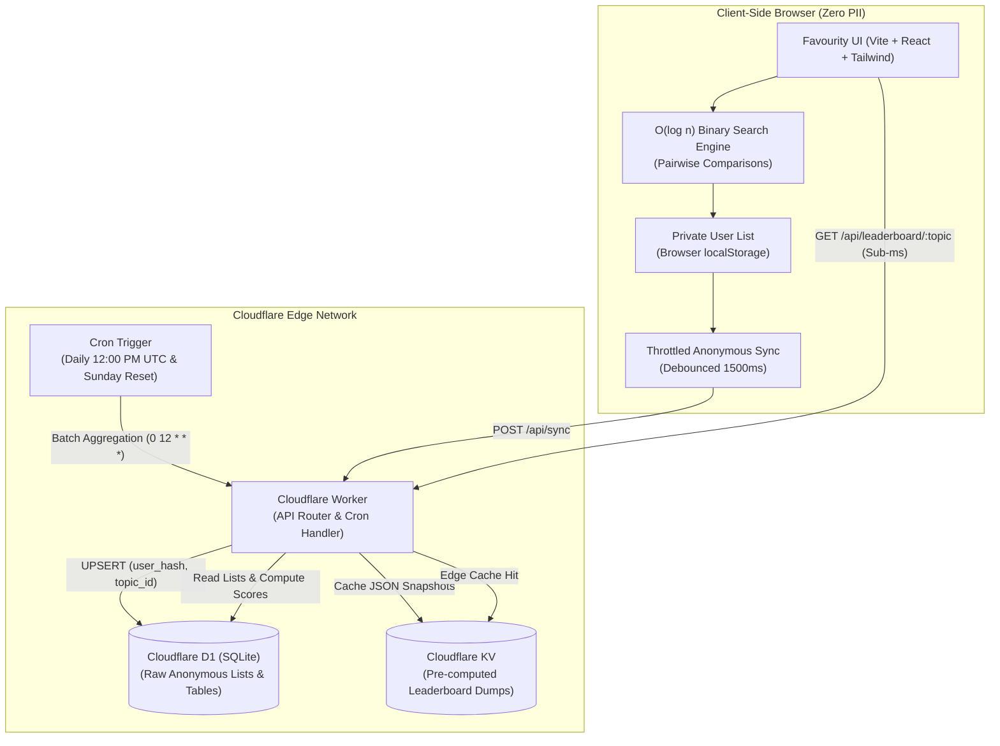

# ⭐️ Favourity — Extensible Ranked List Umbrella Platform

> An extensible umbrella platform hosting modular, topic-specific personal ranked list sub-websites (e.g., **Favourity Food**, **Favourity Movies**, **Favourity Video Games**, **Favourity Tech**). Built with Cloudflare Pages, Cloudflare Workers, Cloudflare D1 (SQL), and Cloudflare KV for the free tier (<100,000 requests/day).

---

## 🏛 Platform Architecture



---

## 🚀 Key Highlights & Architectural Decisions

1. **Client-Side Binary Search Insertion ($O(\log n)$)**:
   - When a user inserts an unranked contender into their personal list of $n$ items, the engine presents pairwise choices ("Do you prefer Option A or Option B?").
   - Instead of tedious manual drag-and-drop or $O(n)$ comparisons, the exact rank position is determined in $\lceil \log_2(n+1) \rceil$ comparisons.
   - **Zero server requests or CPU consumption** occur during comparisons, minimizing edge resource usage.

2. **Zero-PII Privacy & Local-First Storage**:
   - The user's ranked lists reside primarily in `localStorage`.
   - Syncing uses an anonymous, randomly generated cryptographic device hash (`crypto.randomUUID()`) with no tracking cookies, emails, or personal identifiers.

3. **Cost Optimization & Free Tier Compliance (<100,000 req/day)**:
   - **Debounced Sync**: List modifications are debounced (1500ms), batching multiple rapid reorderings into a single `POST /api/sync`.
   - **Batch Aggregation**: Global leaderboards are **never** calculated on-the-fly per page visit.
   - **Edge KV Caching**: Pre-calculated daily JSON leaderboards are stored in Cloudflare KV with aggressive `Cache-Control` headers (`public, max-age=3600, s-maxage=86400, stale-while-revalidate=43200`), delivering sub-millisecond edge responses with minimal D1 reads.

4. **Deterministic Ranking Formula**:
   $$\text{Score} = \frac{\text{Total Times Selected} \times \text{Selection Weight}}{\text{Average Rank Position} + 1}$$
   - Rewards items that are frequently included across community lists, with higher weight given to top rank positions.

---

## 📂 Project Structure

```
.
├── migrations/
│   └── 0001_initial_schema.sql         # D1 database schema and topic seed data
├── scripts/
│   └── verify-platform.js              # Automated architectural verification suite
├── src/
│   ├── config/
│   │   └── topics.ts                   # Modular sub-website topics registry
│   ├── components/
│   │   ├── Header.tsx                  # Global header & sync status pill
│   │   ├── TopicBanner.tsx             # Active topic banner & view toggles
│   │   ├── PersonalRankList.tsx        # Private ranked list & contender catalog
│   │   ├── BinarySearchModal.tsx       # Interactive pairwise comparison modal
│   │   └── GlobalLeaderboard.tsx       # Pre-computed KV edge leaderboard
│   ├── hooks/
│   │   └── useBinarySearchRanking.ts   # Pure TypeScript binary search hook
│   ├── services/
│   │   └── api.ts                      # Throttled sync & KV fetch services
│   ├── utils/
│   │   └── storage.ts                  # Local-first storage & anonymous hash
│   ├── types/
│   │   └── index.ts                    # TypeScript interface definitions
│   ├── worker/
│   │   └── index.ts                    # Cloudflare Worker, API, & Cron handlers
│   ├── App.tsx                         # Main SPA orchestrator
│   └── main.tsx                        # React DOM mounting
├── wrangler.toml                       # Cloudflare Workers, D1, KV, & Cron triggers
├── package.json
├── tsconfig.json
└── vite.config.ts
```

---

## 🛠 Local Development & Verification

### 1. Run Architectural Verification Suite
```bash
npm run build
node scripts/verify-platform.js
```

### 2. Run Database Migrations Locally
```bash
npm run d1:migrate:local
```

### 3. Start Frontend & Worker Locally
```bash
# Terminal 1: Start Worker API & Cron simulation
npm run worker:dev

# Terminal 2: Start Vite Frontend
npm run dev
```

---

## ☁️ Deployment Instructions

### Step 1: Cloudflare D1 & KV Provisioning
Log in to Cloudflare using the Wrangler CLI:
```bash
npx wrangler login
```

Create the remote D1 Database and KV Namespace:
```bash
npx wrangler d1 create favourity-db
npx wrangler kv:namespace create FAVOURITY_KV
```

Copy the generated `database_id` and KV `id` into `wrangler.toml`:
```toml
[[d1_databases]]
binding = "DB"
database_name = "favourity-db"
database_id = "<YOUR_D1_DATABASE_ID>"

[[kv_namespaces]]
binding = "LEADERBOARD_KV"
id = "<YOUR_KV_NAMESPACE_ID>"
```

### Step 2: Apply Remote Migrations
```bash
npm run d1:migrate:remote
```

### Step 3: Deploy Worker & Static Assets
```bash
npm run build
npm run worker:deploy
```

### Step 4: Link GitHub Repository to Cloudflare Pages (Optional alternative)
1. Push your repository to GitHub:
   ```bash
   git remote add origin https://github.com/<username>/favourity.git
   git branch -M main
   git push -u origin main
   ```
2. In the **Cloudflare Dashboard**, navigate to **Workers & Pages** > **Create application** > **Pages** > **Connect to Git**.
3. Select your repository and configure:
   - **Framework preset**: `Vite`
   - **Build command**: `npm run build`
   - **Build output directory**: `dist`
4. Bind the `DB` (D1) and `LEADERBOARD_KV` (KV) namespaces in your Cloudflare project settings.
